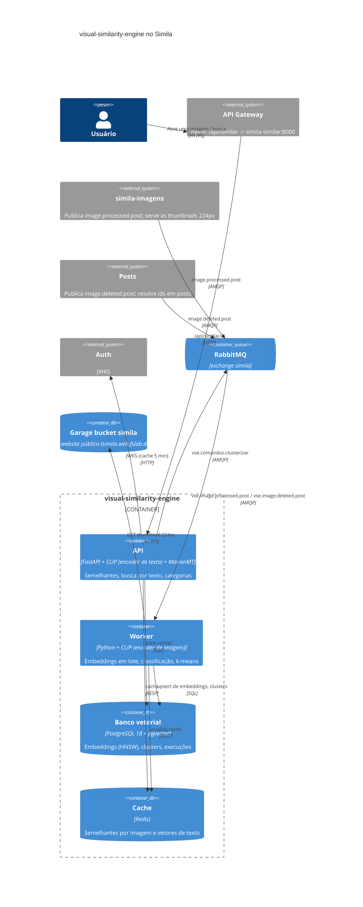
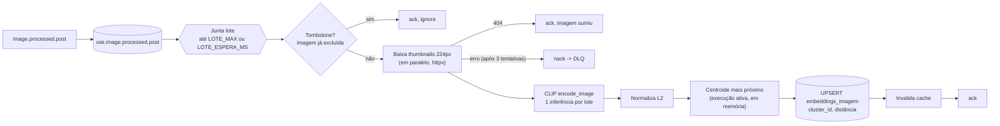
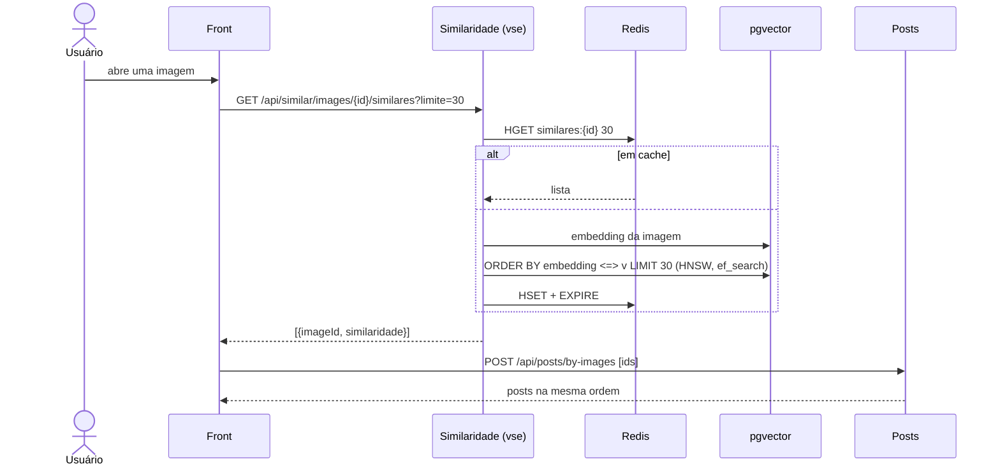

# Arquitetura do visual-similarity-engine

Serviço de IA do grupo no Simila: transforma cada imagem publicada num **embedding CLIP** (ViT-B/32, 512
dimensões), guarda no **pgvector**, responde **imagens semelhantes** (como o "mais como este" do Pinterest),
faz **busca por texto** e organiza as imagens em **categorias** com k-means.

Ele ocupa no Simila o mesmo lugar do serviço `similaridade` do professor: atende `/api/similar` e consome
`image.processed.post` e `image.deleted.post` do simila-imagens.

## C4: contêineres

API e worker são a mesma imagem Docker (comandos diferentes). Os pesos do CLIP vão dentro da imagem.

## Pipeline de embedding

## Busca de semelhantes (fluxo do front)

## Desempenho

| Ponto | Como |
|---|---|
| Inferência | Lote de até `LOTE_MAX` imagens numa só chamada do CLIP; `torch.inference_mode()`; threads em `TORCH_THREADS` |
| Modelo | Carregado uma vez por processo; pesos dentro da imagem Docker |
| Entrada | Thumbnail 224x224 já no tamanho do CLIP: download pequeno, sem resize caro |
| Busca por texto | Consulta traduzida para inglês por um MarianMT local (~85 ms) antes do encoder do CLIP (~25 ms); o vetor fica 1 dia no Redis |
| Busca | Índice **HNSW** (`vector_cosine_ops`, m=16, ef_construction=64); `hnsw.ef_search` configurável |
| Cache | Redis: semelhantes por imagem (TTL 5 min, invalidado quando o vetor muda ou é apagado) e vetor de cada busca de texto (TTL 1 dia). Redis fora do ar não derruba nada |
| Categorias | Imagem nova é classificada na hora pelo centroide mais próximo (produto interno com k vetores em memória); o k-means pesado roda só sob demanda |
| Filas | Canais separados: o prefetch do lote (`LOTE_MAX*2`) não trava exclusões nem o k-means |
| Escala | Mais réplicas do worker dividem a fila; a trava `pg_try_advisory_xact_lock` garante um k-means por vez |

## Decisões

| Decisão | Por quê |
|---|---|
| pgvector (e não um banco vetorial dedicado) | Mesmo Postgres do resto do grupo, transações com clusters e migrações versionadas; HNSW basta para o volume do projeto |
| Vetores normalizados | Distância de cosseno = 1 - produto interno; k-means euclidiano sobre vetores unitários vira k-means esférico |
| Semelhantes por KNN no espaço inteiro, não só dentro do cluster | O cluster é categoria para navegar; restringir a busca a ele perderia vizinhos na fronteira entre clusters |
| k escolhido pela silhueta (cosseno) | Sem número mágico de categorias; testa até 12 valores entre `K_MIN` e `K_MAX` |
| Rótulo da categoria por zero-shot do CLIP | Centroide comparado com "a photo of <termo>" de um vocabulário (`app/clusterizacao.py`) |
| Tombstone `imagens_excluidas` | Evento de exclusão pode chegar antes do processamento: o vetor não é recriado |
| Filas `vse.*` | Não disputa mensagens com o `similaridade` do professor no mesmo broker |
| Busca por texto traduzida para inglês (`TRADUZIR_BUSCA`) | O CLIP só foi treinado em inglês: em português a precisão@10 era 46,4% e com a tradução é 80,7% (`docs/avaliacao.md`); modelo local, sem serviço externo |
| `search-text` exige login; semelhantes é público | A busca por texto roda o encoder (custo de CPU por requisição); semelhantes é leitura barata e cacheada, como a timeline pública |
