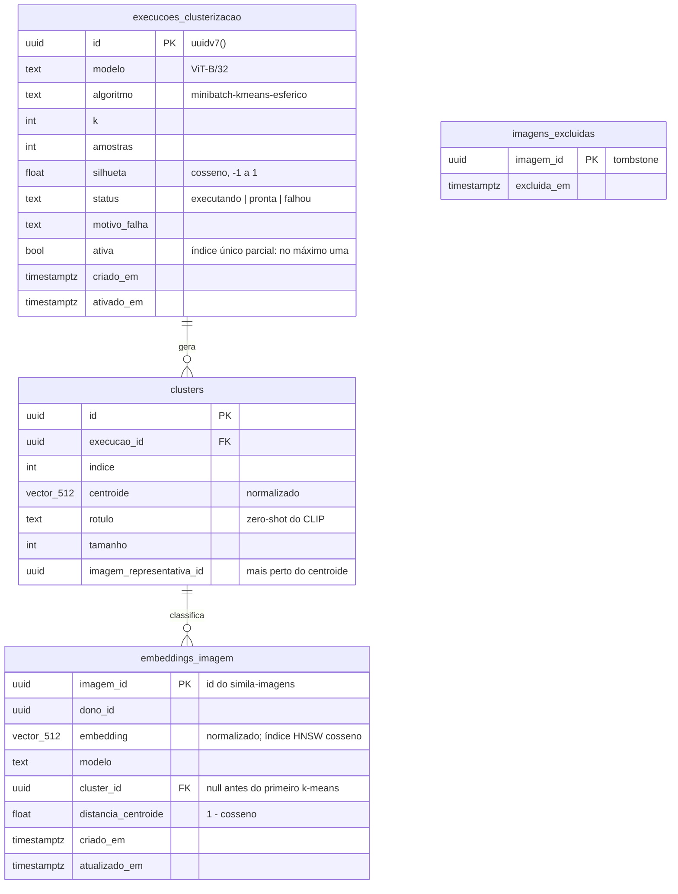

# Banco vetorial

PostgreSQL 18 + extensão **pgvector**, database exclusiva (`vse`). Modelos em `app/models.py`; migrações
Alembic em `alembic/versions/`, aplicadas por comando explícito (`make migrate`).

Índices:

- `embeddings_imagem_hnsw`: `hnsw (embedding vector_cosine_ops) WITH (m = 16, ef_construction = 64)`, usado
  pelo `ORDER BY embedding <=> :vetor LIMIT k`.
- `embeddings_imagem_cluster (cluster_id, distancia_centroide, imagem_id)`: listagem paginada por categoria.
- `execucoes_uma_ativa`: único parcial em `ativa` (`WHERE ativa`).

Execuções antigas e seus clusters ficam como histórico; apagar uma execução apaga seus clusters
(`CASCADE`) e zera o `cluster_id` das imagens (`SET NULL`).
